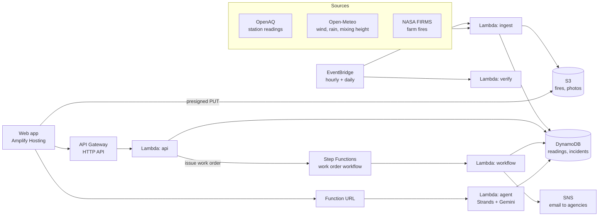

# Wajah

**Delhi has the equipment. It does not know what works. Wajah closes that loop.**

Wajah ("reason" in Hindi) is a control-room tool for Delhi's air pollution. It detects a pollution spike at a hotspot, names the likely cause from sensor data, recommends the matching action and agency, tracks the work order through the field team, and then measures from the sensors whether the action worked. The verdict comes from the sensors, not from the person who did the work.

Hackathon track 01 Air (AQI, pollution exposure, stubble burning).

## The loop

| Step | What happens |
| --- | --- |
| **Detect** | Every hour, each station's PM2.5 is compared with its own usual level (7-day median). A jump to at least 1.5× (or +60) and 90 µg/m³ for 2+ hours is a spike. |
| **Diagnose** | Clues score five causes: local burning, dust, traffic, smoke from farm fires, trapped air. The clues: PM2.5/PM10 ratio, CO and NO2 rise, how many areas spiked, time of day, wind, boundary layer height, and satellite fires upwind. The answer is always "likely", with a confidence level and the clues shown. |
| **Prescribe** | A playbook maps the cause to an action and agency (sprinkling → PWD, anti-burning patrol → MCD, traffic management → Traffic Police). For farm smoke and trapped air: "No local action will help. Do not deploy sprinklers." |
| **Act** | A work order is issued. The agency is notified; the field team marks it started and done and can add a photo, which a vision model checks. |
| **Prove** | Three hours after the job, Wajah compares the change at the hotspot with what would have happened anyway, and records **worked**, **no effect** or **can't judge**. Repeated "no effect" switches the recommendation to the alternative action. |

## Architecture



Each work order is one Step Functions execution: `NotifyAgency → WaitForDone ⇄ CheckDone (→ EscalateOverdue) → WaitForReadings → MeasureEffect → Verdict → EscalateNoEffect | Finished`. Wait times come from the execution input, so the replay demo runs in seconds instead of hours. The hourly ingest also measures any finished work order the workflow missed.

### AWS tools and services, and why

| Tool or service | Why Wajah needs it |
| --- | --- |
| **Strands Agents SDK** (TypeScript) | The duty-officer agent: picks tools, reads the ledger, writes the hourly brief, answers in Hindi or English |
| **SAM CLI** | The whole backend is one template: `infra/template.yaml` |
| **Lambda** | Five functions: `api`, `agent`, `ingest`, `verify`, `workflow` |
| **API Gateway** (HTTP API) | Public REST endpoints for the web app |
| **Step Functions** | Each work order is a long-running process with waits, a deadline and an escalation path; its execution history is the audit trail |
| **EventBridge** | Hourly ingest, daily recurrence check at 06:30 India time |
| **DynamoDB** | Readings, weather, incidents and their work orders |
| **S3** | Completion photos (presigned uploads) and cached fire detections |
| **SNS** | Sends work orders, overdue alerts and no-effect escalations by email, tagged by agency |
| **CloudWatch** | Logs for every function |
| **Amplify Hosting** | Serves the Next.js web app (Track B) |

## Repository

```text
shared/   types (the contract), config (every threshold), playbooks, AQI bands, stations, fixtures
api/      Hono app (local and Lambda), detection, diagnosis, work orders, effect measurement, agent, workflow
infra/    template.yaml (SAM), workorder.asl.json (Step Functions)
scripts/  data test, backfill, replay seed, placebo test, deploy, checks
web/      Next.js app (Track B)
docs/     master PRD, track A PRD, data test results
```

## Run locally (no AWS, no keys)

Needs Node 22 (`nvm use` reads `.nvmrc`).

```bash
npm install
npm test                 # 94 tests: detection, scoring, effect measurement, work orders, store, agent helpers
npm run dev:api          # http://localhost:4000, serving the real-data snapshot in shared/fixtures/snapshot.json
```

Try it:

```bash
curl localhost:4000/health
curl "localhost:4000/incidents?dataset=replay&limit=3"
curl "localhost:4000/stations/anand-vihar/readings?dataset=replay"
npx tsx scripts/contract-check.ts --dataset replay --write   # every endpoint, plus issue → start → done → measure
```

The agent (`POST /ask`) and the photo check also need `GOOGLE_API_KEY` in `api/.env` (see `api/.env.example`).

## Deploy

```bash
aws configure                       # region ap-south-1
cp api/.env.example api/.env        # add keys: OPENAQ_API_KEY, FIRMS_MAP_KEY, GOOGLE_API_KEY
scripts/deploy.sh [WebOrigin] [WebUrl]   # bundles the functions, then sam deploy; keys go in as NoEcho parameters
```

Load data (from the laptop, then copy to AWS):

```bash
STORE_FILE=.data/store.json npx tsx --env-file=api/.env scripts/seed-replay.ts --from 2025-10-29 --to 2025-11-12
STORE_FILE=.data/store.json npx tsx --env-file=api/.env scripts/backfill.ts --days 14 --dataset live
STORE_FILE=.data/store.json npx tsx scripts/placebo.ts --dataset replay
npx tsx scripts/copy-to-dynamo.ts .data/store.json
scripts/subscribe.sh you@example.com [PWD|MCD|DPCC|"Traffic Police"|Residents]
```

Remove everything after judging: `sam delete --stack-name wajah`, and delete the IAM access key.

## Data sources

| Source | Used for | Credit |
| --- | --- | --- |
| [OpenAQ](https://openaq.org) v3 | Hourly readings and history from 37 CPCB/DPCC stations in Delhi | OpenAQ, data from the Central Pollution Control Board and Delhi Pollution Control Committee |
| [Open-Meteo](https://open-meteo.com) | Hourly wind, rain and boundary layer height | Open-Meteo (CC BY 4.0) |
| [NASA FIRMS](https://firms.modaps.eosdis.nasa.gov) | VIIRS satellite fire detections over Punjab and Haryana | NASA FIRMS, LANCE |
| OpenStreetMap | Map tiles in the web app | © OpenStreetMap contributors |

Results of the data test, and why each source was chosen, are in [`docs/data-test.md`](docs/data-test.md).

## Datasets

- **Replay**: 29 October to 12 November 2025, the stubble-burning peak. 405 detected spikes, labelled "Replay" in the app. The demo runs on this.
- **Live**: real readings up to 7 October 2026, when OpenAQ stopped updating Delhi. The government's own feed (data.gov.in) was unreachable on 11 October.

## Known limits

- **Clues, not proof.** The cause is the best fit to public sensor readings, always shown as "likely" with its evidence. Thresholds are hackathon heuristics, all in `shared/src/config.ts`.
- **Wajah only sees where a monitor is.** A job can help a street the station a kilometre away does not see.
- **One verdict is weak evidence.** Hourly air is noisy. In the placebo test (fake work orders on spikes where nothing was done), the method wrongly said "worked" for **62 of 297** judged fakes on the replay data (20.9%), and for 9 of 32 on local spikes in the live data. So the ledger shows counts ("worked 3 of 4"), never a single result.
- **Work orders are simulated** and tagged DEMO. No real agency is connected, and the agency mapping is a simplification: in reality it depends on who owns the road or land.
- **The photo check** confirms the kind of work shown, not where or when the photo was taken. It is shown, never enforced.
